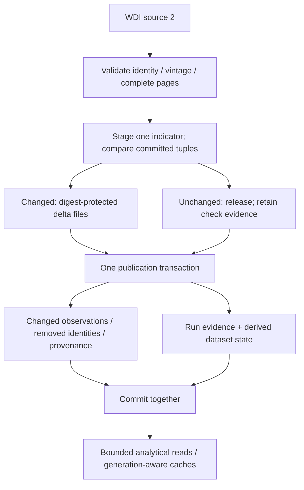

# Optimization architecture and operations

This is the central reference for database cost, performance and correctness.
It describes the implemented libSQL application, not a proposed engine migration.
Read [README.md](README.md) first and [PHASE_5_ACCEPTANCE.md](PHASE_5_ACCEPTANCE.md)
for the final verification record. Benchmarks are local proxies; no production
Turso credentials, ingestion, migrations or deployment were used in Phase 5.

## 1. Goals, measurements and invariants

Reduce avoidable client calls, observation mutations, scans and repeated work while
preserving WDI source 2, exact numeric/raw values, vintages, missingness, countries,
aggregates, cohort membership, ranking ties, denominators and all calculations.
Atomic publication, durability and recovery coverage/provenance proof take priority.
Never treat a newer timestamp, nonzero count or equal per-database version as
proof that a returning primary contains the fallback's committed observations.

A returned row is not a scanned row. A client invocation is not necessarily a
network round trip. `rowsAffected` is a mutation proxy, not a Turso invoice.
Failed/rolled-back operations can still consume hosted resources. No exact
monthly saving or hosted latency improvement is claimed.

## 2. Source map and data flow

| Concern | Implementation |
| --- | --- |
| WDI identities, units, bounds and policy | [config.js](backend/src/config.js) |
| Source-2 transport/pagination/vintage validation | [wb/client.js](backend/src/wb/client.js) |
| Acquisition, stage integrity, publication and locks | [wb/ingest.js](backend/src/wb/ingest.js) |
| Exact changed/removed identity planner | [observationDelta.js](backend/src/wb/observationDelta.js) |
| SQL, derived state and recovery evidence | [repository.js](backend/src/db/repository.js) |
| Batching, narrow read retry and transaction outcome handling | [driver.js](backend/src/db/driver.js) |
| Primary/local initialization and guarded file selection | [db/index.js](backend/src/db/index.js) |
| Runtime target selection and public guards | [server.js](backend/src/server.js) |
| Controlled verification/freshness cadence | [maintenance.js](backend/src/services/maintenance.js) |
| Opt-in resource counters | [metrics.js](backend/src/db/metrics.js) |



## 3. Storage design

[Schema](backend/src/db/schema.sql) contains countries, indicators, observations,
fetch_runs, ingest_year_stats, refresh_locks and dataset_state. Observation identity
is `(country_id, indicator_id, year)`, with foreign keys to country and indicator.
There are no observation mutation triggers. Only valid non-null observations are
stored; an absent row is missing, while zero is retained.

`value` is REAL for numerical operations; `value_raw` preserves the canonical
post-JSON decimal representation for audit. Finite REALs bind as decimal strings
to avoid transport serialization losing precision. `wb_last_updated` is upstream
vintage; `fetched_at` is the last write of that observation, not the latest check.
Run evidence separately records successful unchanged checks.

`dataset_state` is transactionally derived, not an independent source of values.
It supplies counts, years, max stored vintage and content version without repeated
observation scans. Out-of-band repository writes invalidate it; legacy/missing
state uses exact scan fallbacks. Content version advances on value, coverage,
metadata or provenance publication, not merely an unchanged successful check.

## 4. Existing optimizations retained

| Mechanism | Benefit | Bound / limitation |
| --- | --- | --- |
| Derived dataset_state | Metadata reads avoid observation-wide COUNT/MAX/GROUP scans | Must be maintained in publication; absent state scans |
| Focus history projection | One country, requested indicators/window, required predecessor only | Real GDP growth needs prior-year constant GDP |
| 500-statement batches | Fewer client round trips and bounded builders | Does not itself reduce rows written |
| Exact unchanged-indicator proof | Zero observation writes on identical refresh | Still downloads/validates historical source input |
| Provenance-only UPDATE | Retains raw/numeric values when vintage advances | Every changed vintage row genuinely needs a write |
| Digest-protected disk staging | One indicator at a time in memory | Temporary disk and cleanup remain necessary |
| Short atomic publication | No upstream network wait in the write transaction | Real large revisions can still be expensive |
| Years / Compare / Status caches | Reuse stable historical and verification work | Per handle/process; invalidation evidence required |
| In-flight browser GET sharing | Collapses equivalent concurrent requests | Settled responses are not a persistent browser database |
| Refresh locks / retry cooldown | Prevent overlapping runs and upstream retry storms | Process retry state disappears on restart |
| Guarded failover/recovery | Preserves last valid committed dataset | Full content/provenance proof can require legitimate scans |

No existing safety optimization was replaced by a fashionable cache or SDK.

## 5. SQL reads and query projection

A bounded Overview previously repeated indicator lookup, existence probe, eligible
population read and focus-series read for each metric, plus focus/universe metadata:
18 SELECT/client calls for four GDP metrics. `getOverviewInputs` now issues five
SELECTs in one SDK `batch(..., 'read')`: eligible count, focus metadata, requested
indicator/existence metadata, eligible observations for requested metrics/years,
and one-country predecessor/current series. These share a committed read snapshot.
The non-batch test-handle fallback also uses an explicit read transaction.

Numeric calculation order, metric iteration, rank engine, raw fields and DTOs are
unchanged. All eligible economies for the selected ranking years remain necessary;
a one-country Overview with ranks cannot honestly use only one country's values.
Queries without explicit bounds retain the existing discovery path.

Examples of actual restrictions:

```sql
-- Bounded history: existing primary-key/country index lookup.
SELECT year, value, value_raw AS valueRaw
FROM observations
WHERE indicator_id = ? AND country_id = ? AND year BETWEEN ? AND ?
ORDER BY year;

-- Ranking: all mathematically required eligible values for one indicator/year.
SELECT o.country_id AS iso3, c.name, o.value, o.value_raw AS valueRaw
FROM observations o JOIN countries c ON c.id = o.country_id
WHERE o.indicator_id = ? AND o.year = ? AND c.is_aggregate = 0;
```

`getFocusHistoryRows` already uses requested metric keys, country and range, adding
only the constant-GDP predecessor required for real growth. It was preserved.
Pagination keeps existing page-based compatibility, rank positions and denominators.
No keyset migration or window-formula rewrite was justified by these fixtures.

## 6. Index engineering and plans

| Index / constraint | Actual purpose | Decision |
| --- | --- | --- |
| Observation primary key | Unique observation identity; country/indicator/year search | Required; retained |
| `idx_observations_country` | Explicit same-column country-history access | Potentially redundant with PK; retained pending a separately rehearsed migration |
| `idx_observations_ind_year_value` | Indicator/year/range search and value ordering | Required hot-path index; retained |
| Country aggregate flag / ISO3 | Eligible population and entity lookup | Retained |
| Indicator code / metric UNIQUE | Canonical registry identity and lookups | Never drop |
| Fetch-run started DESC | Recent operational history | Retained |
| Ingest-stat metric/year + PK | Coverage/vintage/run evidence | Retained |

History plans show indexed country/indicator/year SEARCH; the new Overview batch
uses the existing indicator/year access path. Sorting and full population scans
remain legitimate where the requested ranking/proof requires them. EXPLAIN text
is diagnostic, not a CI string contract. No new index, schema version or production
migration was introduced.

The disposable storage benchmark inspects index pages with dbstat when supported.
Its attempted transaction-local duplicate-index drop can return SQLITE_LOCKED in
the installed libSQL client; the transaction rolls back and the index remains.
This is a disclosed experiment limitation, not justification to force DDL or weaken
locking. A future consolidation must demonstrate the same-engine before/after
plan, interruption, rollback, write/storage benefit and remote compatibility.

## 7. Write amplification: exact deltas

Before Phase 5, any changed observation caused this work for its entire refreshed
indicator/range:

```sql
DELETE FROM observations WHERE indicator_id = ? AND year BETWEEN ? AND ?;
-- followed by an UPSERT for every staged row in the slice
```

After validation, `observationDelta` compares the same already-read stored tuples
against the complete incoming payload. Identity, numeric value, exact raw string
and vintage all participate. It emits only changed/new upserts and removed keys.
Removed keys use the existing primary key:

```sql
DELETE FROM observations
WHERE country_id = ? AND indicator_id = ? AND year = ?;
```

The existing UPSERT retains identity and bound decimal values; INSERT OR REPLACE
is not introduced. Both delta streams are digest-protected staging files and are
replayed in the SAME publication transaction as audit stats and derived state.
An omitted observation is removed only after complete upstream validation. An
incomplete page, wrong source, vintage regression or failed indicator publishes
nothing. Recovery's preserve-key restriction is checked before delta planning.

An unchanged numeric value with revised raw text or provenance is not a no-op.
For an entirely value-identical indicator, the existing targeted provenance-only
UPDATE remains preferable to rewriting values. For mixed changes, required new
vintages participate in upserts. Unchanged rows retain their last-write timestamp.
`rowsUpserted` means physical upserts; per-year coverage counts remain coverage
facts and are not replaced by delta counts. Deletions are separately observable
through affected-row counters. Run/lock/stat records remain necessary writes.

## 8. WDI acquisition, validation and transactions

Historical acquisition is deliberately retained: WDI can revise old observations.
No unsupported ETag, last-year-only retrieval or invented release contract is used.
The client verifies source 2, indicator identity, page counts/totals, JSON bodies,
years, duplicate/conflicting observations, country identity and vintage. Existing
request timeouts, bounded retries and failure cooldowns remain.

Stage acquisition occurs outside the write transaction. Independent input may be
retrieved using existing bounded concurrency; never create thousands of unbounded
promises. Publication contains database work and local stage replay only. Commit
uncertainty retains the existing confirmation/rollback semantics. Never retry a
possibly committed write blindly; a fresh verified transaction is required.

Tests cover 502/503, timeout, malformed/truncated input, incorrect identity/source,
incomplete pages, partial indicators, interrupted publication and rollback. Initial
publication and a genuine broad revision still need proportionate writes. Atomicity
is not traded for smaller transaction latency.

## 9. Turso/libSQL client and usage interpretation

The shared `@libsql/client` 0.18.0 handle is reused; this work does not migrate to
Turso's newer engine, sync SDK or ORM. The installed ResultSet reports rows and
rowsAffected; it does not expose provider-billed row scans. Batch and transaction
capabilities were checked against installed types and the official SDK reference.
A read batch reduces client invocations while preserving its snapshot. Its exact
wire requests depend on transport/session behavior and were not measured remotely.

Current [Turso usage documentation](https://docs.turso.tech/help/usage-and-billing)
distinguishes scans from returned rows and notes that aggregates, updates, joins,
index creation and aborted writes can consume resources. Therefore local counters
cannot be converted directly to billed rows or a monthly dollar promise. Keep
provider plan/engine definitions attached to any owner-authorized usage comparison.

## 10. SQLite fallback and durability

The same SQL and decimal bindings serve local and remote handles. Local setup
requests WAL and foreign keys; hosted Turso controls its journaling separately.
The storage fixture observed WAL, synchronous=2 (FULL), 4096-byte pages and a
zero busy_timeout. These are observed installed-build defaults, not a promise for
every host. No synchronous/journal safety was reduced and no speculative PRAGMA
or new tuning ENV was added.

Indexes, short transactions, delta writes and bounded read batches also benefit
fallback. File/WAL/SHM sizes and dbstat pages are recorded by `bench/storage.js`.
WAL growth is not inherently corruption: long-lived readers can prevent checkpoint
progress. Do not delete a live WAL/SHM file. Investigate reader lifetime, contention,
disk capacity and checkpoint policy on the actual filesystem before tuning it.

## 11. Failover and recovery

Startup and runtime failover distinguish configured primary from actual serving
handle. Missing, empty, corrupt or ineligible fallback files are not accepted just
because they exist. Single-flight/cooldown guards prevent repeated outage probes.
Returning-primary promotion requires valid registry/indicator identity, all fallback
observation keys, and per-observation value/raw/provenance coverage. A changed
value requires the required newer source evidence. Primary-only valid observations
must remain; the fallback is not copied over primary as an automatic repair.

`verifyRecoveryCoverage` uses read transactions on both candidates. Local content
versions are never compared as cross-database content identities. Inconclusive,
interrupted or failed reconciliation keeps the serving fallback. Healthy traffic
never pays a full recovery proof per request. Rare exhaustive recovery reads remain
intentional. This phase preserves rather than weakens that evidence requirement.

Storage workloads verify equal content, safe restoration, local serving and
rejection of a candidate missing a fallback key. Full regression tests cover
vintage divergence, equal clocks/different content, partial failures, outages,
concurrency, interrupted reconciliation and recovery retry. Actual hosted transport,
filesystem persistence and account-specific rollout remain owner verification.

## 12. Cache inventory and invalidation

| Cache / owner | Identity and bound | Invalidation / failure behavior |
| --- | --- | --- |
| Years / yearsCache | WeakMap per handle; one content-version payload | New generation; legacy exact fallback. Key and payload now use one state read |
| Compare / compareCache | Per handle LRU, 64 entries; authoritative version (legacy results uncached), metric, basis, operation, mode, ordered entities/labels/years | Changed values, vintage/coverage or registry evidence changes key; blocked results not cached |
| Status / statusCache | Three bounded slots per handle: legacy, cheap, expensive | Success-run key / content+vintage key; same-key cold misses share one proof; failures clean pending state |
| Overview / singleFlight | WeakMap per handle; max 64 active keys including options | Concurrent work only; all success/failure promises removed at settle; no settled stale result |
| Geo / geo.js | Max 500 salted address-digest entries; 30-minute TTL | Validated successes only; failures never poison later recovery |
| Browser GET / api/client.js | Equivalent in-flight URL requests with per-caller cancellation/deadline | Removed at settle; no cross-generation settled response cache |
| Publication availability / hook | Latest backend confirmation and request ordering | Fail closed; existing route/focus/visibility/online/status refresh behavior |

The Compare cache's reset-all seam now replaces its WeakMap; WeakMaps cannot be
enumerated. No database handle is retained solely by cache ownership. Absent/invalid derived
state bypasses settled Compare caching: count/vintage cannot prove unchanged
values. Valid publication versions avoid the old per-hit historical COUNT/MIN/MAX
signature scan. Provenance publication advances that version. Recovery proofs
remain exhaustive and do not use this cache shortcut. The Status
slot refuses an older pending generation overwriting a newer result. No failure
is cached indefinitely. Entry limits do not claim a measured byte-perfect memory
cap; legitimate large Compare DTOs still deserve heap monitoring.

No Redis or HTTP cache was added. Public capability, location and publication
responses retain no-store behavior. Conditional caching must never bypass the
backend publication decision; previously downloaded/external copies cannot be
revoked by changing a flag.

## 13. Controlled freshness and integrity persistence

The existing 24-hour policy and refresh locks decide whether a refresh is due.
Legacy GET compatibility is retained, but server-controlled checks are gated to
one/minute per target, independent of query-string churn. Public aliases and UI
passive reads do not trigger that path. Boot owns initial acquisition/stale checks;
a single unreferenced minute timer continues maintenance without depending on
visits. It skips overlap, respects readiness and is stopped on shutdown.

GET Status no longer writes integrity metadata for any spelling of readOnly.
Maintenance obtains a read snapshot, reuses or computes the exact version/vintage
proof, closes the read transaction and conditionally persists it only for the
unchanged generation. Failed proofs are not persisted. Changed publication clears
verification. Existing valid persisted reports remain usable across restarts.
The timer adds at most bounded minute-level metadata work; it is a deliberate
tradeoff for freshness even when all clients use passive reads.

## 14. API, network and abuse protection

`PUBLIC_READ_API_ENABLED` is parsed as exact 1 and is the sole authority for optional
aliases/discovery. Direct docs/catalog/sitemap functions recheck it and fail closed.
Case/trailing-slash aliases and HEAD share read accounting. The bounded client
budget map holds at most 2048 address entries; ordinary read allowance is 60/minute.
Refresh has a separate bearer authorization and attempt limiter. JSON is bounded
at 64 kB. No bot exemption, SQL diagnostic endpoint or client-selectable database
is introduced. Request values remain bound and dynamic identifiers allowlisted.

History is limited to 100 annual years and eight registered series. Comparison
entity/range validation and existing page-size bounds remain. Evidence/raw fields
are not removed to make payloads smaller. Compression/ETag middleware was not added
without measurement; host-level transfer compression must be checked separately.
Legacy and public equivalents share service work where safe; publication checks
still precede optional access. Hiding links or CORS is not backend authorization.

## 15. Frontend loading, rendering and network work

Only the active analytical workspace mounts. React.lazy/Suspense now splits twelve
research sections while keeping the shell, selectors, navigation and themes intact.
The research loading fallback is explicit and keyboard/touch controls remain in the
shared shell. Chart code loads when its route needs it. The measured entry decreased
from a freshly built 1,133,664-byte monolith (286,935 gzip) to 309,722 bytes
(95,510 gzip), using the same patched build toolchain; chart and
section chunks still download for relevant research views. This is deferred loading,
not removal of analytical capability or proof of lower total bytes for every route.

Existing shared GET deduplication, bounded read recovery, abort cleanup and dataset
watcher remain. Theme/chart viewport changes do not refetch economic data. The
central geographic lifecycle retains early hints until registry validation, gives
valid URL/manual choices precedence, bounds failed attempts and initializes Compare
A only. B remains empty. No virtualization, expensive memoization framework or
visual redesign was introduced. Test flushing waits for dynamic imports, so tests
assert loaded behavior rather than racing Suspense.

## 16. CPU, memory and concurrency

The measured improvements remove repeated I/O and calculation for concurrent
identical Overview requests. Batches and delta staging limit intermediate work.
No worker pool, global unbounded result cache or alternate runtime was introduced.
Rank/YoY continue sorting the mathematically required population with their original
tie-breaks. Full integrity/recovery remains expensive once per required proof.

`observeDatabase` is opt-in and keeps only fixed scalar counters; it emits no SQL,
parameters, tokens, database URLs or visitor addresses. It tracks execute/batch/
transaction/commit/rollback counts, result rows, affected rows and client duration.
Benchmarks also capture CPU, heap delta, RSS and response bytes. Heap deltas may be
negative due to GC; concurrent cumulative client time is not wall time. These are
operation-local diagnostics, not privileged public telemetry or per-request DB writes.
Explicit execute/batch statements are counted; executeMultiple scripts are separate
scriptCalls because the SDK exposes no parsed script statistics. Insert versus
update within UPSERT and physical index writes are not separately observable.

## 17. Reproducible benchmarks

From `backend`, using Node 24 and installed locked dependencies:

```sh
node bench/run.js --years 22 --output <temporary-22.json>
node bench/run.js --years 66 --output <temporary-66.json>
node bench/refresh.js --output <temporary-refresh.json>
node bench/storage.js --output <temporary-storage.json>
```

`--source <immutable-backend-checkout>` measures the same workload against another
source revision. Preserve the baseline before implementation. Use the same runtime,
fixture, parameters, cache condition and machine; never load private ENV or attach
an existing dataset. The tools clear remote credentials, force test isolation and
create disposable WAL files; read/API fixtures use the existing eligible registry,
all 20 indicators, deterministic sparse coverage, zeros, permitted signed values,
and multiple vintages. The two analytical sizes contain 91,704 and 275,118 rows.

Analytical workloads use five samples except the expensive audit/concurrent cases.
Cold and subsequent warm counters are stored separately. With that sample count,
p95/p99 are deliberately not estimated. A separate same-handle, interleaved
50-sample-per-version warm Overview experiment reports upper-median/p95
30.061/41.048 ms before and 27.851/40.486 ms after. No p99 is inferred.
Reproduce with `node bench/run.js --paired-only --paired-source <baseline-backend> --output <temporary-paired.json>`. Shared-host timings are indicative and can
be distorted by concurrent test/benchmark activity; deterministic client/row/write
counts are the primary acceptance evidence. No remote transport simulation is
presented as actual Turso usage. The refresh fixture has a 660-row historical metric
slice plus all other registered fixture indicators, with valid source-2 envelopes.

## 18. Before/after results

The machine-readable [measurement record](benchmarks/phase5-results.json) contains
workload counters, payload hashes, cold/warm metrics and disclosed limitations.

| Workload | Before | After | Reduction / interpretation |
| --- | ---: | ---: | --- |
| One-year four-metric Overview client calls | 18 | 1 | 94.4%; SELECTs 18 to 5 |
| Eight simultaneous identical Overviews | 144 | 1 | 99.3%; 6,704 to 834 returned rows |
| Cold available-year client calls | 2 | 1 | 50%; one consistent state row |
| One changed historical observation, affected rows | 1,320 | 1 | 99.92% mutation proxy reduction |
| Ten additional historical corrections | 1,320 | 10 | 99.24% mutation proxy reduction |
| Forty-nine additional corrections | 1,320 | 49 | 96.29% mutation proxy reduction |
| One removed observation | 1,319 | 1 | No surviving rows rewritten |
| New year for ten economies | 1,330 | 10 | Only the new identities inserted |
| Completely unchanged refresh observation writes | 0 | 0 | Existing optimization retained |
| Provenance-only update affected observations | 16,907 | 16,907 | Required metadata, deliberately retained |
| Failed upstream partial refresh observation writes | 0 | 0 | Atomic publication preserved |

Exact normalized economic response fingerprints agree across the before/after
analytical workloads. Operational Status differs only in the fixture initialization clock at
lock.updatedAt; removing that operational field gives exact parity. It is
checked separately; do not hide those differences behind numerical tolerances.
All refresh logical observation fingerprints agree after each corresponding
workload, including partial failure and retry. Calculation regressions compare
exact values/raw/provenance and cohorts; no broad floating tolerance was added.

## 19. Hosted usage and cost-management procedure

After separately authorized deployment, the owner should establish a quiet baseline
window, record database/engine/plan, dashboard read/write/storage totals, refresh
runs, traffic, instance count and dataset size. Repeat matched windows after release,
separating initial cache fills, publication, integrity proofs and recovery from warm
serving. Account for concurrent deployments, retries and source revisions. Use
provider-supported query diagnostics and observed scans, not response row counts,
to validate billing impact. Review the current plan's quota/overage definitions
before making a cost model. No Turso account telemetry was accessed here.

## 20. Rollout, backup, rollback and configuration

No new ENV or schema/index migration is needed. Preserve all active local and remote
configuration, credentials and primary/fallback targets. Owner rollout should:

1. Review the final diff, locked security versions, tests and fixture measurements.
2. Take and verify provider-supported backups and a consistent local fallback
   backup. A live main-file copy without its WAL is not a valid backup procedure.
3. Deploy the backend first, then the frontend functions/chunks as a coordinated
   release; verify passive APIs, publication off/on, readiness and serving target.
4. Verify real ingress location, documented routes, charts, exact evidence and
   account usage. Confirm that the minute cadence does not duplicate another
   operator scheduler; locks still protect publication.
5. Roll back application artifacts if needed without reverting or truncating the
   dataset. Old code remains schema-compatible; it may resume less efficient full
   slice replacement. Do not copy fallback over primary to manufacture rollback.

The fixture suite proves transaction rollback and recovery guards, not an actual
cloud backup restoration. Owner backups, real Turso transport and production
rollout/rollback were not executed or claimed tested.

## 21. Troubleshooting

| Symptom | First evidence / action |
| --- | --- |
| Read spikes | Separate cold integrity/recovery from warm endpoints; inspect client counters and query plan |
| Write spikes | Inspect run changed/skipped/vintage counters; distinguish true revisions from unchanged checks |
| Slow histories | Confirm country, metric and annual bounds; inspect indexed SEARCH and predecessor need |
| Slow rankings | Check population size, sort/tie semantics, payload and concurrency; do not reduce denominator |
| Cache misses | Check handle identity, content version, vintage, entity labels/membership and basis |
| Refresh failure | Check validation/error class, page completeness, last valid publication and lock cleanup |
| Large WAL / contention | Find long reads/writes and disk limits; never delete live sidecar files |
| Recovery loops | Inspect cooldown, coverage/provenance proof and actual serving target; never promote on ping alone |
| HTTP 429 | Honor Retry-After; check proxy addressing and client concurrency; no User-Agent exemptions |
| Startup delay | Distinguish liveness, readiness, empty acquisition, fallback eligibility and missing derived state |
| Location unavailable | Verify deployed function/route, trusted ingress and registry ISO2; preserve manual fallback |

## 22. Maintenance rules and tradeoffs

Review representative query plans after schema/query changes, lockfile advisories
regularly, and account metrics after actual releases. Keep cache keys aligned with
all analytical inputs, prove invalidation for metadata/provenance, and use a fresh
read snapshot for multi-query results. Keep deterministic resource ceilings in CI;
avoid fragile latency or EXPLAIN-string assertions.

Do not add indexes, PRAGMA tuning, cache layers, credentials or ENV flags without a
measured bottleneck and compatibility evidence. Ignored `.agents` guidance may be
missing from a fresh clone; these permanent rules are the maintained authority.
Known costs remain exhaustive verification/recovery, full legitimate cohorts,
complete historical WDI acquisition and true provenance advances. No production
billing, geographic accuracy or deployment security PASS follows from local fixtures.

## 23. Primary references

- [SQLite query plans](https://www.sqlite.org/eqp.html), [query planning](https://www.sqlite.org/queryplanner.html), [WAL](https://www.sqlite.org/wal.html), [online backup](https://www.sqlite.org/backup.html).
- [Turso TypeScript reference](https://docs.turso.tech/sdk/ts/reference), [libSQL client 0.18 interface](https://tursodatabase.github.io/libsql-client-ts/interfaces/Client.html), [usage/billing](https://docs.turso.tech/help/usage-and-billing).
- [World Bank API documentation](https://datahelpdesk.worldbank.org/knowledgebase/articles/889392-about-the-indicators-api-documentation).
- [Express security guidance](https://expressjs.com/en/advanced/best-practice-security.html), [proxy trust](https://expressjs.com/en/guide/behind-proxies.html).
- [React lazy](https://react.dev/reference/react/lazy), [Suspense](https://react.dev/reference/react/Suspense), [Vite build](https://vite.dev/guide/build.html).
- [Vite security advisories](https://github.com/vitejs/vite/security/advisories), including [the patched virtual-module advisory](https://github.com/vitejs/vite/security/advisories/GHSA-p4f5-76q4-ffq7).
