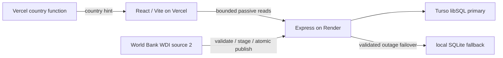

# World Bank WDI Economic Research Platform

An independent research application for exploring World Bank World Development
Indicators across economies and years. World Bank WDI **source 2** supplies the
observations; this application calculates ranks, denominators, YoY changes,
comparisons and Movement results. It is not an official World Bank product.

The backend registers 20 indicators in eight subjects: GDP per capita, Total GDP,
Prices, Trade, Capital flows, Exchange rates, External sector and Population.
Each indicator keeps its own units, coverage, change rules and source vintage.

## Research workspaces

- **Overview and Data:** selected-economy evidence and historical annual values.
- **Rank and YoY:** complete rankings, search, pagination and country verification.
- **Movement:** period analysis, peer universes, decomposition and evidence.
- **Compare:** countries, custom groups and official aggregates; observed and
  like-for-like analysis where the measurement contract supports them.
- **Coverage and Audit:** valid populations, missingness, source identity,
  ingestion evidence and calculation methodology.
- **Data Status:** dataset freshness, refresh outcomes, bounded diagnostics and
  protected operator refresh.

The interface includes persistent light/dark themes, responsive charts and tables,
fixed chart axes, annual line/bar modes, touch tooltips and exact-value disclosure.
Shared geographic initialization chooses an eligible economy when trusted location
information is available. Manual and valid URL choices take precedence. Fresh
Compare A uses the initial focus; B remains empty until chosen.

Optional public API documentation, a machine-readable catalog and human research
pages support AI retrieval and search discovery. Publication is controlled by the
backend; it does not confer permission to refresh or mutate data.

## Architecture



Both serving paths use `@libsql/client` and the same repository SQL. Recovery
requires observation coverage and provenance proof; a successful ping or newer
clock is insufficient. An ephemeral Render filesystem is not a durable backup.

## Stack and prerequisites

Use Node.js **24 or newer** and npm with lockfile support. Development verification
uses Node 24.22.2, React 19.3.0, Recharts 3.10.1, Express 5.2.1 and libSQL client
0.18.0. Frontend Vite is pinned to the approved 8.3.8 security patch; inspect the
lockfile for its compatible Rolldown resolution. No ORM, Redis or additional
infrastructure is required. The local SQLite client includes native bindings;
use a supported Node/platform combination.

## Installation and local development

```sh
git clone <repository-url>
cd <repository-directory>
cd backend
npm ci
cd ../frontend
npm ci
```

Prepare configuration only if the corresponding file does not already exist.
Never overwrite a working `.env` or copy production credentials into fixtures.

PowerShell, from the repository root:

```powershell
if (!(Test-Path backend/.env)) { Copy-Item backend/.env.example backend/.env }
if (!(Test-Path frontend/.env)) { Copy-Item frontend/.env.example frontend/.env }
```

Linux/macOS:

```sh
test -e backend/.env || cp backend/.env.example backend/.env
test -e frontend/.env || cp frontend/.env.example frontend/.env
```

Review the examples before starting. For a fresh local workspace, choose a local
`DB_MODE` and a local `DATABASE_FILE`; clear any inherited remote database target
in your development process. Merely changing a filename does not override an
explicit Turso mode or URL.

In separate terminals:

```sh
cd backend
npm run dev
```

```sh
cd frontend
npm run dev
```

Open `http://localhost:5173`. The backend defaults to port 3001. Vite proxies data
requests to that backend; its own `/api/location` handler ignores supplied
geographic headers and reports location unavailable. Private/loopback addresses
cannot identify a visitor's public country. Local development offers manual
selection unless the existing resolver receives a verified public client address.

## Configuration

The backend reads `backend/.env` outside tests; process configuration is validated
in [config.js](backend/src/config.js). Vite reads frontend build configuration.
Do not put secrets in any `VITE_*` variable, which is exposed to the browser.

| Variable | Default / purpose | Production requirement |
| --- | --- | --- |
| `PORT` | `3001` | Hosting-assigned port is supported |
| `DB_MODE` | Automatic target selection; `local` or `turso` overrides | Verify the actual serving target |
| `DATABASE_FILE` | `backend/data/worldbank.db` | Durable local storage if fallback is required |
| `TURSO_DATABASE_URL` | Unset; selects remote primary when configured | Owner-provided target, never a fixture credential |
| `TURSO_AUTH_TOKEN` | Unset | Owner-provided secret for authenticated Turso |
| `ALLOW_LOCAL_DB_FALLBACK` | `true` | Existing local file must pass eligibility checks |
| `PUBLIC_READ_API_ENABLED` | Disabled unless exactly `1` | Sole publication authority |
| `REFRESH_ADMIN_TOKEN` | Unset | Required secret for production boot/refresh |
| `CORS_ORIGINS` | Development default when unset | Required exact allowed frontend origins in production |
| `CACHE_TTL_HOURS` | `24` | Freshness policy, distinct from content generation |
| `WB_AUTO_INGEST_ON_EMPTY` | `true` | Starting an empty configured target can WRITE data |
| `WB_AUTO_REFRESH_ON_STALE` | `true` | Enables controlled background freshness checks |
| `WORLD_BANK_API_BASE_URL` | Official World Bank v2 API | Keep the authoritative source; tests use a loopback stub |
| `GEO_PROVIDER_URL` / `GEO_TIMEOUT_MS` | Existing keyless fallback / 3000 ms | Requires trustworthy public client addressing |
| `VITE_API_BASE_URL` | Relative API locally | Existing Render API base at build and documentation-function runtime |
| `VERCEL_PROJECT_PRODUCTION_URL` | Platform-provided | Used for verified absolute canonical/social origins |

`VITE_PUBLIC_READ_API_ENABLED` is deprecated and ignored. Neither value controls
publication. Do not fabricate Vercel runtime variables or weaken Express proxy
trust to make geolocation succeed. No ENV changes are required by Phase 5.

## Data setup and write-capable commands

An empty configured database can ingest at startup when enabled. A nonempty valid
dataset remains served during background refresh; partial input publishes nothing.
The default acquisition range includes historical years, because WDI can revise
older observations. Source 2, indicator identity, pagination, vintage and numeric
validation precede publication.

**The following backend commands can write to the configured database or contact
live WDI. Inspect the target first; do not run them against production casually:**

```sh
npm run ingest
npm run refresh:http
npm run snapshot:create
npm run audit:live
```

Fixtures are explicitly synthetic or captured test inputs, not a replacement for
production WDI data. Safe tests and benchmarks override database/network settings
before importing configuration and never load private ENV files.

## Commands and verification

| Directory | Command | Purpose |
| --- | --- | --- |
| `backend` | `npm start` | Production backend process |
| `backend` | `npm run dev` | Backend with Node watch |
| `backend` | `npm test` | Complete isolated Node test suite |
| `backend` | `node bench/run.js --years 66 --output <temporary-result.json>` | Deterministic analytical/HTTP resource benchmark |
| `backend` | `node bench/refresh.js --output <temporary-result.json>` | Synthetic WDI refresh amplification benchmark |
| `backend` | `node bench/storage.js --output <temporary-result.json>` | Disposable startup/index/WAL/recovery benchmark |
| `frontend` | `npm test -- --maxWorkers=2` | Full Vitest/jsdom suite |
| `frontend` | `npm run lint` | Static checks |
| `frontend` | `npm run build` | Production chunks and human research documents |
| `frontend` | `npm run preview` | Inspect the built frontend locally |

Prefer a disposable checkout for the full integration suite. Include tracked
`.env.example` templates needed by contract tests, but never private `.env` files
or the developer's `backend/data` directory. Tests need loopback HTTP access;
a sandbox permission error is not evidence of a product regression.

## Public API and AI retrieval

The backend enables `/api/public/*` only when `PUBLIC_READ_API_ENABLED=1`.
`GET /api/capabilities` returns its current non-secret decision with no-store
caching. When enabled, the frontend serves `/public-data/`, `/data-catalog.json`
and `/sitemap.xml` through a runtime function that confirms backend authority.
Unavailable authority fails closed for optional publication; human pages remain.

Example bounded reads, relative to the intended backend:

```text
GET /api/public/countries?includeAggregates=false
GET /api/public/indicators
GET /api/public/focus/history?country=IND&series=total_current&startYear=2004&endYear=2025
GET /api/public/ranking?indicator=total_current&year=2024&page=1&pageSize=50
```

Source attribution and exact evidence remain in responses. The shared public and
legacy analytical read budget is 60 requests/minute per server-resolved address,
including HEAD and case/trailing-slash variants. No bot User-Agent bypass exists.
HTTP 429 includes `Retry-After`. Human-facing legacy APIs remain available when
optional publication is disabled; hiding documentation is not API authorization.

UI reads use `readOnly=1`; public aliases are intrinsically passive. Legacy TTL
checks retain compatibility but run at most once/minute per serving target.
A server-owned minute cadence also checks freshness independently of traffic.
GET Status never persists verification, regardless of `readOnly` spelling;
controlled maintenance owns that generation-conditional write.

## Performance and database operations

Measured Phase 5 fixture improvements include 18 to 1 client calls for bounded
Overview, 144 to 1 for eight identical concurrent Overviews, and 1,320 to 1
affected observation rows for a single historical correction. These are local
client/write proxies, **not measured Turso-billed usage or monetary savings**.
Unchanged refresh already wrote zero observation rows and still does.

Read [OPTIMIZATION.md](OPTIMIZATION.md) for SQL plans, existing and new caches,
delta publication, recovery proofs, telemetry limitations, benchmarks, rollout,
backup/rollback considerations and troubleshooting.

## Deployment and production checks

- **Render:** backend root `backend`, dependency installation from lockfile,
  start command `npm start`, configured production token/CORS/Turso settings.
  Preserve targets and credentials. The service listens before data readiness;
  distinguish liveness `/api/health` from readiness and serving-provider state.
- **Vercel:** frontend root `frontend`, `npm run build`, output `dist`. Include
  both `api/location.js` and `api/public-documents.js`; package the latter's HTML
  shell using `vercel.json`. Specific publication rewrites must reach that
  function. A catch-all API proxy must not intercept `/api/location`.
- Keep the existing API base available to the browser build and documentation
  function runtime. Vercel supplies the trusted country hint; the backend registry
  must expose usable ISO2 fields. Plain static hosting cannot enforce a remote
  backend's runtime documentation-publication decision.
- Deploy backend and frontend as a coordinated owner-controlled release. Verify
  API off/on, passive reads, no-store policies, real geographic initialization,
  Compare A/B, canonical documents, charts and fallback/recovery afterward.

No schema/index migration or ENV change is introduced by Phase 5. No deployment,
production database operation or remote setting change was performed. Previous
live checks found an older bundle, unavailable location route and null backend
geo result; local fixtures do not prove that the hosted ingress is now fixed.

## Security and limitations

Refresh requires the configured bearer token, timing-safe comparison and its
separate limiter; JSON bodies are bounded at 64 kB. SQL values are bound and
identifiers allowlisted. Proxy trust remains conservative. CORS is a browser
policy, not authentication. Do not expose development servers to untrusted
networks or publish database clients, SQL diagnostics or private ENV files.

Report security concerns privately to the repository owner using the hosting
provider's private reporting channel, if available. Include affected revisions
and a minimal reproduction without credentials, raw visitor IPs or private data.
There is no claim of perfect security or an invented reporting address.

Operational limits include one process-local cache per backend instance, genuine
full-population ranking costs, expensive first-generation integrity verification,
provider/network outages and production-only billing/ingress verification. VPN
exit country may differ from residence. Exact raw text is canonical post-JSON
precision, not recoverable lexical digits lost by the upstream JSON parser.

## Project structure

```text
backend/
  src/db/          SQL repository, schema, client, opt-in metrics
  src/domain/      economic calculations and measurement contracts
  src/services/    analytical builders, bounded caches, maintenance
  src/wb/          WDI validation, staging and atomic publication
  src/scripts/     explicitly invoked operational commands
  test/            isolated regression fixtures and tests
  bench/           safe reproducible performance workloads
frontend/
  api/             Vercel location and publication functions
  server/          local development/preview endpoint handlers
  src/components/  reusable controls, charts and evidence tables
  src/hooks/       requests, publication and shared economy lifecycle
  src/sections/    lazily loaded analytical workspaces
OPTIMIZATION.md    central engineering and cost reference
PHASE_5_ACCEPTANCE.md  final verification record
```

## Methodology and attribution

A missing observation is absent, never invented as zero. Genuine zeros and signed
values keep their indicator-specific transformation rules. Ranking populations
exclude official aggregates; group sums do not impersonate official published
aggregate observations. Like-for-like analysis explicitly uses its common
universe. Ranks and YoY are calculated by this application, not published WDI ranks.

Consult the [World Bank Indicators API documentation](https://datahelpdesk.worldbank.org/knowledgebase/articles/889392-about-the-indicators-api-documentation),
[World Bank data terms](https://www.worldbank.org/en/about/legal/terms-of-use-for-datasets),
and each indicator's source notes and licensing/attribution requirements.
